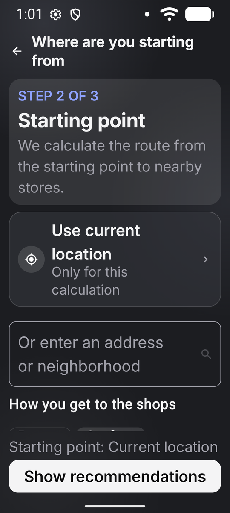
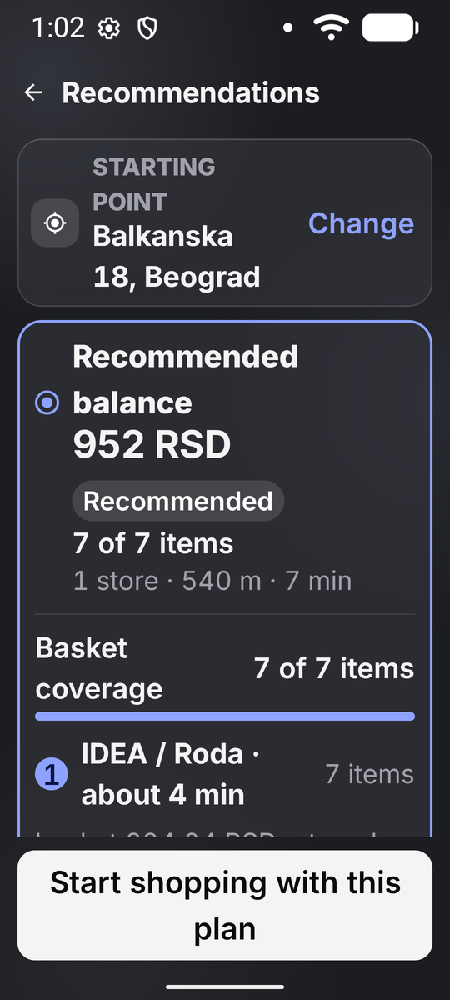
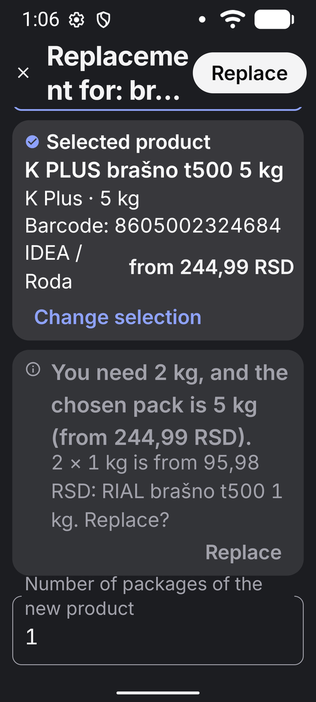
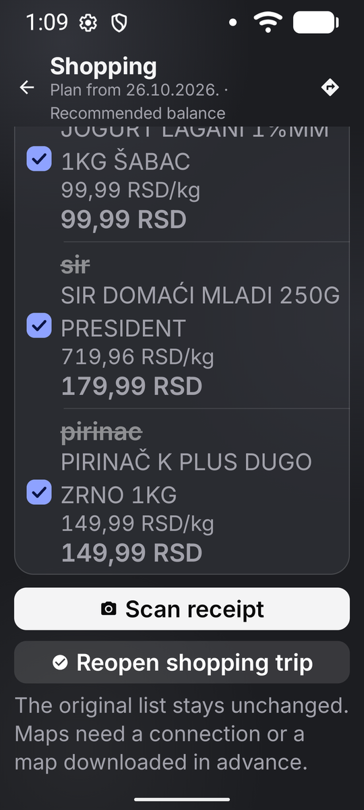
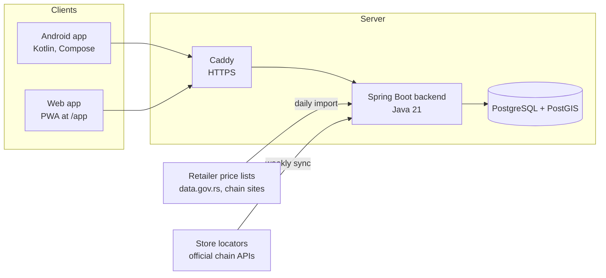

# Pametna kupovina (Smart Shopping)

[](https://github.com/Milki19/pametna-kupovina/actions/workflows/ci.yml)

An Android app and Spring Boot backend that turn a plain shopping list into a
shopping plan for one or two nearby stores in Serbia. You type the list the way
you normally would ("milk, bread, 2x beer, cevapi 3kg") and the app tells you
where the whole basket is cheapest, counting the price of the basket, the
distance, the time on the road and the number of stops.

Prices come from the official price lists that Serbian retailers have to
publish by law (Maxi, IDEA, Roda, Lidl, Univerexport, METRO, DIS, Super Vero,
dm, Gomex and others). The server downloads and imports them every day.

**Live:** https://pametna-kupovina.duckdns.org (web version at `/app`, can be
added to the phone home screen). Current version: 2.0.7.

| Starting point | Shopping plan | Product replacement | Finished trip |
| --- | --- | --- | --- |
|  |  |  |  |

## Features

- **Shopping plan** with three options: the cheapest basket in a single store,
  the best balance of price and travel, and the lowest price split across two
  stores.
- **Product matching across chains.** The same brand and package size is
  compared directly; free-text items ("yogurt") are matched to a category with
  optional brand and size limits.
- **Barcode scanning** to add a product from the shelf.
- **Fiscal receipt scanning** (QR code): spending by month, store and category.
- **Price alerts** for products you follow.
- **Shared household list** joined with one QR code.
- **Loyalty cards** stored in the app.
- **Privacy first:** no name, email or password needed. Precise location is
  used for one calculation and never stored on the server.

## Architecture



**How a recommendation is built**

1. Each list item is matched to a canonical product or a product category.
   Items that are ambiguous are sent back to the user for confirmation.
2. Up to 20 verified stores within the search radius are selected with PostGIS.
3. For each store, the valid price on the requested date is picked
   (store, then store format, then the whole chain; promo prices only inside
   their declared period).
4. Every single store and every pair of stores (at most 190 pairs) is scored.
   Travel cost, time value and cost per stop are configurable and returned to
   the client together with the result, so the user can see what the plan
   assumes.

Distances use a straight line with a detour factor by default; an OSRM adapter
is ready for real road distances. Details are in
[docs/optimization/recommendation-api.md](pametna-kupovina-backend/docs/optimization/recommendation-api.md)
(Serbian).

**Price import.** Retailers publish price lists as CSV, XLSX, PDF or through
their own APIs, each in a different format. The importer streams large files
to disk and processes them in two passes so a full snapshot never sits in
memory. New sources start as `DISCOVERED` and are only used after review.
Data quality checks track coverage per chain and per store.

**Product name matching** combines text rules with an optional multilingual
embedding model (multilingual-e5-small, ONNX Runtime) that suggests products
with the same meaning across chains.

## Tech stack

| Part | Technologies |
| --- | --- |
| Backend | Java 21, Spring Boot, Spring Security, JDBC, Flyway (140 migrations), PostgreSQL 16 + PostGIS, Apache POI, PDFBox, Commons CSV, ONNX Runtime |
| Android | Kotlin, Jetpack Compose, Material 3, Hilt, Room, Retrofit, kotlinx.serialization, WorkManager, DataStore, ML Kit code scanner, Credential Manager (Google sign-in) |
| Web | Vanilla JavaScript PWA served by the backend |
| Testing | JUnit 5, Testcontainers (real PostgreSQL), MockRestServiceServer, Android unit tests |
| Infra | Docker Compose, Caddy, GitHub Actions, Oracle Cloud (Always Free ARM), automated backups and health checks |

## Repository layout

```
pametna-kupovina-backend/   Spring Boot service, Flyway migrations, web app in static/app
pametna-kupovina-android/   Android app
infra/                      Local database, production Compose, deploy/backup scripts
design/                     App icon
play-store.md               Play Store listing texts
```

## Running locally

Requirements: JDK 21, Docker, Android Studio (for the app).

```bash
# Database (PostGIS) for development
docker compose -f infra/compose.yaml up -d

# Backend tests (Testcontainers starts its own PostgreSQL)
cd pametna-kupovina-backend
./mvnw test

# Android unit tests and debug build
cd ../pametna-kupovina-android
cp local.properties.example local.properties   # set the server address
./gradlew testDebugUnitTest assembleDebug
```

To run the backend with the daily price import, see
[infra/README.md](infra/README.md). Configuration comes from environment
variables (`DB_URL`, `DB_USERNAME`, `DB_PASSWORD`, `ADMIN_API_KEY`, ...);
the full list for production is in
[infra/.env.production.example](infra/.env.production.example).

## Deployment

Production runs on a single Oracle Cloud ARM machine with Docker Compose:
PostgreSQL/PostGIS, the backend, Caddy for HTTPS and a backup job. Release,
deploy, backup and restore scripts are in [infra/ops](infra/ops), and the
server setup is described step by step in [infra/ORACLE.md](infra/ORACLE.md)
(Serbian). Files with real passwords and database dumps are never committed.

---

## Ukratko na srpskom

Pametna kupovina je Android aplikacija sa Spring Boot serverom koja od spiska
za kupovinu pravi plan kupovine u jednoj ili dve obližnje prodavnice. Cene se
svakog dana uvoze iz zvaničnih cenovnika koje lanci objavljuju po Pravilniku, a
u obračun ulaze cena korpe, put, vreme i broj stajanja. Aplikacija radi na
https://pametna-kupovina.duckdns.org. Detaljna dokumentacija za server i
puštanje nove verzije je u [infra/README.md](infra/README.md).
